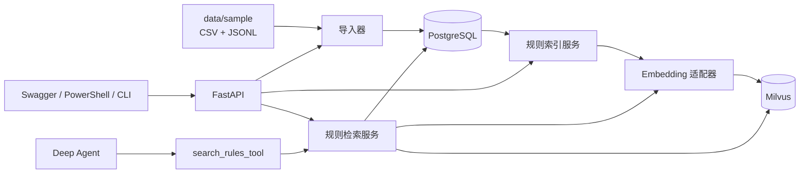

# TikTok 选品 Agent

## 逐期交付

当前 `v2` 已新增单品分析、成本计算、JSON/Markdown 报告和 PostgreSQL 检查点。
操作见 [第二期说明](docs/phase-2-guide.md)，各期进度与真实验收结果见
[逐期交付记录](docs/delivery-status.md)。下文保留第一期基础组件使用说明。
第三期 `codex/v3` 增加多 Agent、双向量集合、混合检索和索引 outbox，
使用方法见 [第三期说明](docs/phase-3-guide.md)。
第四期 `codex/v4` 提供 Celery 后台任务、故障恢复、SSE 与 Vue 页面，
启动各进程见 [第四期说明](docs/phase-4-guide.md)。

一个面向个人项目和面试展示的证据驱动选品研究原型。当前版本聚焦于一条可运行、可追溯的数据链路：导入商品、评论和规则样例，保存证据元数据，为规则生成向量并写入 Milvus，再通过 FastAPI、CLI 或 Deep Agent 检索可引用的规则证据。

项目不会把相似度、合成评论或模型输出包装成市场事实。规则检索结果用于提示需要核验的事项，不构成法律、合规、医疗、安全或商业建议。

> 当前实现：第一期 `v0.1.0`。任务编排、报告生成、后台 Worker、SSE、前端工作台和评测闭环仍属于后续设计，详见 [v2 技术架构方案](docs/TikTok选品Agent技术架构方案-v2.md)。

## 当前能力

| 模块 | 已实现内容 |
| --- | --- |
| 数据导入 | 导入 CSV 商品、CSV 评论与 JSONL 规则；按文件组合摘要识别重复导入批次。 |
| 证据追溯 | PostgreSQL 保存来源、市场、品类、观察时间、内容摘要、版本和原始结构化载荷。 |
| 向量检索 | 使用 `MilvusClient` 写入和搜索规则证据；集合名由 Embedding 提供方、模型名和维度隔离；搜索按市场过滤。 |
| Embedding | 支持离线确定性 `mock` 向量，以及任意 OpenAI 兼容 Embedding 服务。 |
| Agent | 使用 LangChain `deepagents` 创建真实 Deep Agent；只注册只读的 `search_rules_tool`。 |
| API | 提供健康检查、样例导入、规则索引、规则检索和 Agent 演示接口。 |
| CLI | 提供数据库迁移、导入、索引、检索和 Agent 演示命令。 |
| 开发体验 | PyCharm 本地运行 API；Docker Compose 仅运行 PostgreSQL、Redis、Milvus 及其依赖；支持 `INFO` / `DEBUG` 日志。 |
| 验证 | 提供 PowerShell 验收脚本、中文合成样例和不依赖外部服务的单元测试。 |

## 系统架构



规则检索采用“两段式”流程：Milvus 负责按向量和市场召回候选证据 ID；服务层再回查 PostgreSQL，返回标题、来源、版本、时间和文本片段。这样向量库只承担召回，业务证据与追溯信息仍以 PostgreSQL 为准。

## 数据流

1. `import-sample` 读取 `data/sample/` 下的三类文件，计算组合 SHA-256，并创建一个 `ImportBatch`。
2. 商品写入 `products`；评论和规则标准化为 `evidence`，每条记录携带来源、市场、品类、版本与内容摘要。
3. `index-rules` 从 PostgreSQL 读取 `rule` 类型证据，调用 Embedding 服务，并按稳定 `evidence_id` 写入 Milvus。
4. `rules/search` 将查询文本转为向量，按 `market` 过滤召回，再从 PostgreSQL 恢复可追溯字段。
5. `agent-demo` 将研究问题交给 Deep Agent。Agent 只能调用 `search_rules_tool`，不能执行 Shell、写文件或访问任意 SQL。

## 项目目录

```text
app/
  agents/          # Deep Agent 创建与调用
  core/            # Settings、Embedding 适配器、日志配置
  db/              # SQLAlchemy 模型、会话、Alembic 调用
  ingestion/       # CSV / JSONL 样例导入与批次摘要
  repositories/    # PostgreSQL 查询与 MilvusClient 访问
  services/        # 索引与检索业务编排
  tools/           # 供 Deep Agent 调用的最小只读工具
  main.py          # FastAPI 常驻服务入口
  cli.py           # 一次性维护和验收命令入口
data/sample/       # 20 条商品、20 条评论、20 条规则的中文合成样例
docs/              # 环境、CLI、样例数据、验证和后续架构说明
scripts/           # Windows PowerShell 启动与验收脚本
tests/             # 配置、样例、Embedding 和 MilvusClient 单元测试
```

## 快速开始

### 1. 准备依赖服务

需要 Docker Desktop 与 Python 3.12 Conda 环境。先创建 `.env`（已有手动配置时不要覆盖），然后启动依赖容器：

```powershell
Copy-Item .env.example .env  # 仅首次且 .env 尚不存在时执行
docker compose up -d
docker compose ps
```

默认容器包括 PostgreSQL、Redis、Milvus、etcd 和 MinIO。API 默认不在 Docker 中运行，由 PyCharm 使用本机 Python 启动；需要 API 容器时才显式执行：

```powershell
docker compose --profile container-api up -d --build api
```

### 2. 安装 Python 依赖并迁移数据库

```powershell
$projectPython = 'D:\Programs\anaconda3\envs\py12\python.exe'
& $projectPython -m pip install -e '.[dev]'
& $projectPython -m alembic upgrade head
```

### 3. 用 PyCharm 启动 API

在 PyCharm 新建 Python 运行配置：

| 字段 | 值 |
| --- | --- |
| Run | `Module name` |
| Module name | `uvicorn` |
| Parameters | `app.main:app --host 127.0.0.1 --port 8000 --reload` |
| Working directory | `$PROJECT_DIR$` |
| Interpreter | `D:\Programs\anaconda3\envs\py12\python.exe` |

启动后访问：

- Swagger API 文档：`http://127.0.0.1:8000/docs`
- 健康检查：`http://127.0.0.1:8000/health`
- Milvus Web UI：`http://127.0.0.1:9091/webui/`

更完整的 PyCharm 配置、系统环境变量和模型设置说明见 [PyCharm 本地启动说明](docs/pycharm-run.md)。

### 4. 验证完整流程

API 已启动时，执行：

```powershell
.\scripts\verify-phase1.ps1
```

脚本会调用 API 导入样例、索引规则并检索验证；因此无需在脚本前再执行同一组 CLI 命令。

## CLI 与 FastAPI 的区别

| 入口 | 命令 | 用途 |
| --- | --- | --- |
| `app.main` | `uvicorn app.main:app ...` | 常驻 FastAPI 服务，供 Swagger、PowerShell、前端或其他客户端调用。 |
| `app.cli` | `python -m app.cli <命令>` | 一次性执行数据库迁移、导入、索引或检索，不启动 Web 服务。 |

例如，不启动 API 时可手动运行：

```powershell
$projectPython = 'D:\Programs\anaconda3\envs\py12\python.exe'
& $projectPython -m app.cli init-db
& $projectPython -m app.cli import-sample
& $projectPython -m app.cli index-rules
& $projectPython -m app.cli verify --query '食品收纳容器的密封宣传需要核验什么' --market US
```

CLI 全部命令、参数、执行顺序与中文乱码处理见 [CLI 命令说明](docs/cli-usage.md)。

## API 一览

| 方法 | 路径 | 功能 |
| --- | --- | --- |
| `GET` | `/health` | 验证 PostgreSQL 连通性，并返回不含密钥的模型配置摘要。 |
| `POST` | `/api/imports/sample` | 导入项目内置合成样例；重复调用返回已有批次。 |
| `POST` | `/api/indexes/rules` | 生成规则 Embedding 并写入当前向量空间对应的 Milvus 集合。 |
| `POST` | `/api/rules/search` | 按查询文本和市场检索规则证据，返回来源、版本和相似度。 |
| `POST` | `/api/agent-demo` | 使用真实聊天模型运行 Deep Agent，模型会按需调用规则检索工具。 |

检索请求示例：

```json
{
  "query": "食品收纳容器的密封宣传需要准备哪些资料？",
  "market": "US",
  "top_k": 3
}
```

## 中文合成样例

当前样例每类 20 条，合计 60 条记录：

| 文件 | 内容 | 说明 |
| --- | --- | --- |
| `data/sample/products.csv` | 商品名称、市场、品类和内嵌 JSON 规格 | 20 个商品，覆盖 8 个品类。 |
| `data/sample/reviews.csv` | 评分、变体、中文评论和观察时间 | 20 条与商品一一关联的评论。 |
| `data/sample/rules.jsonl` | 中文规则核验提示、市场、品类、版本、来源和时间 | 20 条可索引规则证据。 |

样例覆盖 `US`、`UK`、`DE` 三个市场。所有 `source_url` 都使用 `example.invalid` 占位地址，`data_kind` 固定为 `synthetic`。它们用于验证软件流程和检索过滤，不能当作真实评论、法规或市场数据。

字段字典、导入幂等逻辑、旧样例升级方式和替换为自有数据的要求见 [合成样例数据说明](docs/sample-data.md)。

## 模型与配置

配置通过系统环境变量和项目根目录 `.env` 读取；系统环境变量优先。项目不绑定任何厂商名，使用通用字段：

```dotenv
EMBEDDING_PROVIDER=openai_compatible
EMBEDDING_MODEL=<文本向量模型名称>
EMBEDDING_DIM=<模型实际返回维度>
EMBEDDING_REQUEST_DIMENSIONS=<可选；仅服务支持时填写>
EMBEDDING_BATCH_SIZE=10
MODEL_API_KEY=${LOCAL_MODEL_API_KEY}
MODEL_BASE_URL=<OpenAI 兼容接口地址>
CHAT_MODEL=<支持工具调用的聊天模型名称>
```

`EMBEDDING_PROVIDER=mock` 时不需要 API Key，适合验证工程流程；它生成确定性哈希向量，不表示真实语义效果。`EMBEDDING_BATCH_SIZE` 控制每次真实 API 请求携带的文本数，默认 10 以兼容常见的接口限制。切换提供方、模型或维度会生成独立 Milvus 集合，需要重新执行 `index-rules`。

阿里百炼等 OpenAI 兼容服务的配置示例及系统变量映射见 [PyCharm 本地启动说明](docs/pycharm-run.md)。真实模型模式会产生模型调用费用。

## 日志与调试

默认 `LOG_LEVEL=INFO`，会输出导入、向量生成、Milvus 写入、检索和 Agent 的关键步骤。调试时设置：

```dotenv
LOG_LEVEL=DEBUG
```

`DEBUG` 额外输出查询预览、前三条证据 ID 和相似度、批次摘要等少量数据，不输出 API Key。修改后重启 FastAPI 或重新执行 CLI 命令。

## 开发检查

```powershell
$projectPython = 'D:\Programs\anaconda3\envs\py12\python.exe'
& $projectPython -m pytest
& $projectPython -m ruff check app tests
```

PowerShell 自动验收、常见故障和离线/真实模型的边界见 [第一期验证说明](docs/phase-1-verification.md)。Docker Desktop 安装与启动见 [Docker 环境说明](docs/docker-setup.md)。

## 当前边界与下一步

当前版本只索引规则文本，评论数据已完成结构化导入但尚未建立评论向量索引，也没有销量、价格、成本、竞品或真实外部数据接入。Deep Agent 目前只有一个只读规则检索工具，尚未实现任务恢复、工作流编排、报告生成或前端。

下一步计划是在保持证据追溯的前提下，加入评论洞察、确定性成本计算、结构化报告、LangGraph 外层工作流、后台任务与可复现评测。完整的分期目标、技术取舍和验收指标见 [v2 技术架构方案](docs/TikTok选品Agent技术架构方案-v2.md)。
