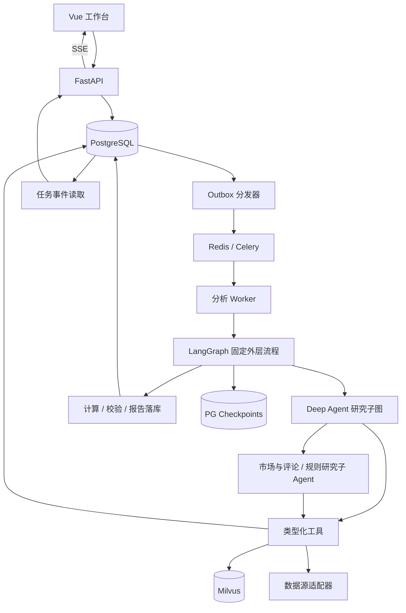

# TikTok 选品 Agent 技术架构方案 v2

> 适用：个人项目、Python 后端 / AI 应用开发面试。  
> 修订日期：2026-10-19。  
> 确定保留：LangChain 官方 `deepagents`、LangGraph、Milvus。  
> 本文是待实施设计；周期、预算和指标均为规划或验收目标，不代表已经实现或实测。  
> 默认业务范围：美国市场、家居收纳品类、单品分析；可按实际可获得的数据调整。

## 1. 项目定位与成功标准

构建一个证据驱动的商品分析系统：用户提交商品数据和分析问题，系统结合评论、可比商品、规则资料和成本参数进行研究，按需补充查询，输出可追溯的分析报告。

个人项目重点证明四件事：

1. Deep Agent 能根据中间发现选择下一步工具，而非仅执行固定提示词。
2. Milvus 检索能找到相关证据，且证据的市场、日期、版本可检查。
3. 数值由确定性工具计算，主要结论能追溯至数据，缺失信息会明确暴露。
4. 任务可查询、可取消、可恢复，有效果、耗时和成本的对照评测。

业务价值表述为“辅助选品研究和候选商品筛选”。没有真实后续销售验证时，不宣称能预测爆款或提高销售成功率。

### 1.1 范围取舍

| 必做 | 后续增强 | 当前暂缓 |
| --- | --- | --- |
| 单品分析、数据导入、证据引用、成本测算 | 一个可用的外部数据接口 | 大范围实时爬虫、多市场全品类 |
| Deep Agent 研究、专项子 Agent、Milvus 检索 | 相似商品召回、产品图片分析 | 默认六个 Agent 全量执行 |
| 后台任务、SSE、恢复、预算限制 | 小批量比较、竞品监控 | K8s、集群、多租户、企业 SSO |
| 结构化报告、评测、演示案例 | Word 导出、界面精修 | 自动上架、采购和投放 |

风险模块提供规则证据、适用范围和待核实事项；不把“未检索到风险”转换为“无风险”。

## 2. 技术选型与职责

| 组件 | 选型 | 项目内职责 |
| --- | --- | --- |
| 语言 | Python 3.11 或以上，首期确定一个小版本 | 服务、工具、任务、评测 |
| API | FastAPI + Pydantic | 参数校验、任务和报告接口 |
| Agent | 官方 `deepagents` | 有边界的研究循环、规划、上下文管理、子任务委派 |
| 执行流程 | LangGraph | 固定流程、条件分支、检查点恢复 |
| 模型 | 一个主力文本模型 + 一个 Embedding 模型 | 通过通用 OpenAI 兼容接口接入；先验证工具调用和结构化输出，再考虑多模型 |
| 持久库 | PostgreSQL + SQLAlchemy + Alembic | 业务数据、证据、事件、报告、outbox |
| 图检查点 | PostgreSQL 持久化 checkpointer | 恢复图状态；与业务表区分职责 |
| 向量库 | Milvus Standalone + pymilvus | 语义召回、元数据过滤、索引实验 |
| 后台任务 | Celery + Redis | 分发分析和索引任务；Redis 兼任可丢失缓存 |
| 前端 | Vue 3 + TypeScript | 商品输入、阶段进度、报告、证据展开 |
| 事件推送 | SSE | 单向进度和结果通知 |
| 导出 | python-docx | 从已验证的报告 JSON 生成 Word |
| 部署 | Docker Compose | 固定版本的本地可复现环境 |
| 观测 | 结构化日志 + PG 调用记录 | task_id、run_id、调用量、耗时、错误、费用估算 |

不用旧方案中的宽泛 `>=` 依赖作为最终环境。第一期执行兼容性冒烟测试后，提交锁文件、Python 版本、镜像版本及模型标识。本文不指定未经实际验证的包版本组合。

## 3. 总体架构



第一版采用模块化单体：一个代码库、API 与 Worker 两种进程，不拆微服务。Outbox 分发器可以是同一代码库中的轻量轮询进程；启动恢复扫描也由它负责，暂不额外引入 Celery Beat。

### 3.1 三层职责边界

- **Celery**：把某个 run 交给 Worker 执行，处理队列投递与进程级重投递；不知道研究应当查什么。
- **LangGraph 外层流程**：控制数据校验、研究、计算、验证、持久化等阶段，控制终态和恢复边界。
- **Deep Agent 研究子图**：在工具、证据、预算约束内决定研究动作；不能绕过最终校验直接发布报告。

两者可组合使用，但首期必须验证父图与 Deep Agent 子图的状态映射、检查点命名空间和恢复方式，避免外层只能恢复到“重新执行整个研究”的程度。

## 4. 数据方案：先有可用证据，再扩大来源

### 4.1 数据输入

| 数据 | 首期来源 | 后续扩展 | 缺失处理 |
| --- | --- | --- | --- |
| 商品与规格 | CSV / JSON 导入 | 已验证的数据 API | 关键规格缺失则要求补充 |
| 评论 | 可使用的数据集或合法导出 | 评论数据源适配器 | 明确样本量和抽样范围 |
| 竞品价格 | 同规格的人工录入 / 导出 | 商品查询 API | 不比较明显不可比的规格 |
| 历史销量 | 有日期的真实或估算序列 | 有授权的历史数据接口 | 无序列则不输出增长结论 |
| 成本与运费 | 用户输入、报价快照 | 报价接口 | 输出缺失项和情景分析 |
| 平台规则 | 人工导入有来源的规则片段 | 定期更新 | 标注市场、适用日期、核验状态 |

首期准备约 10 个开发案例；后续扩展到 20～30 个商品用于演示与评估。真实、估算、人工录入、模拟数据分别标识。模拟数据可验证软件流程，不能证明商业效果。

接口可用性、费用与数据授权在接入前单独确认，不把尚未获取到的数据写成已具备的能力。

### 4.2 证据契约

每条证据至少包含：

```text
evidence_id, entity_id, source_type, source_url（可空）,
source_record_id, market, category, observed_at, fetched_at,
valid_from, valid_to（可空）, data_kind,
content_hash, content_version, raw_payload_ref
```

`data_kind` 为 observed / estimated / manual / synthetic。导入文件没有 URL 时，以文件 SHA-256、行号和导入批次定位来源。规则的发布时间、采集时间和生效时间分别存储。

每次分析冻结 `dataset_snapshot_id` 与证据版本；同一 run 的恢复沿用该快照。新增数据后重新分析则创建新的 run，避免报告引用不断变化的“当前数据”。

报告中的声明统一为：

```json
{
  "claim_id": "C01",
  "statement": "本批次大号规格评论中，多条评论提到盖子松动",
  "kind": "observation",
  "evidence_ids": ["E12", "E18"],
  "limitations": ["样本来自同一导入批次，不能代表全市场"]
}
```

区分 observation（观察）、inference（推断）、assumption（假设）。校验引用存在只能证明“有引用”，是否真正支撑结论还需要语义核验或人工评测。

## 5. Deep Agents 设计

### 5.1 集成方式

采用官方 `from deepagents import create_deep_agent` 构建研究 Agent，接收适配后的模型、工具及专项子 Agent；集成参数以锁定版本的官方 API 为准。

外层流程：

```text
请求校验 → 冻结输入快照 → 数据充分性检查
    → Deep Agent 研究 → 确定性成本与评分计算
    → 证据和输出校验 → 原子保存报告与完成事件
```

关键输入缺失时进入 `waiting_input`；风险待核实时输出待核实结论或暂停，不由模型随意把任务标成成功。

### 5.2 一个主 Agent + 两个专项子 Agent

| 角色 | 工作内容 | 工具边界 | 输出 |
| --- | --- | --- | --- |
| 主研究 Agent | 拆解问题、选择研究方向、发现证据冲突、组织补查 | 只读业务查询、专项委派、受限研究文件 | 研究摘要、证据、缺口 |
| 市场与评论子 Agent | 评论痛点、规格差异、可比商品、有限趋势分析 | 评论筛选、商品查询、统计、相似检索 | 主题、计数、引用、样本限制 |
| 规则研究子 Agent | 检索适用规则、核对市场和日期 | 规则检索、证据详情 | 适用规则、风险线索、待核实项 |

成本计算和报告导出是工具 / 服务，不为凑数量增加 Agent。第三期才加入两个专项子 Agent；第二期先让主 Agent 真实调用工具跑通。

### 5.3 真实的自主研究行为

演示案例：用户问“这个收纳盒适不适合进入候选清单？”

1. Agent 检索评论，发现密封问题。
2. 查询规格分布，判断问题是否集中于大号。
3. 如有必要，查询可比商品对应规格的差评主题。
4. 发现缺少运费报价时列出缺口，使用明确标记的假设做敏感性分析。
5. 输出有条件的建议，并说明哪些条件需要用户补充验证。

若工具没有更多数据，明确停止研究，不反复调用同一查询，也不凭常识填充事实。

### 5.4 预算与上下文

建议初始配置：每个 run 总模型调用上限 20 次、总工具调用上限 30 次、最多同时运行 2 个子任务、总运行时限 5 分钟。均包含主 Agent、子 Agent、修复调用和重试；这些是初始保护阈值，后续按实测调整。

调用前由应用层预留预算，调用后结算；并行子 Agent 共用 run 级预算账本。除次数外还记录输入 / 输出 token 和供应商费用估算。余额不足时停止新增研究，保留阶段结果；没有通过校验的部分结果不能冒充完整报告。

Deep Agents 虚拟文件用于存放任务内研究笔记和大结果摘要。文件路径按 run 隔离，原始证据仍由 PG 管理。采用有持久化 backing 的 backend 或可恢复的图状态，并测试重启后内容仍可读取。文件 backend、checkpointer 与长期记忆是不同机制。

首版只开放只读业务工具及受限笔记写入；不开放任意 shell、任意 SQL 或任意文件路径。网页和评论中的指令视为数据，不作为工具执行授权。长期记忆仅接纳人工确认的经验，模型报告不自动成为事实知识。

## 6. 工具与模型契约

### 6.1 工具接口

| 工具 | 输入重点 | 输出重点 |
| --- | --- | --- |
| get_product_snapshot | product_id、snapshot_id | 商品和规格、来源 |
| query_reviews | 商品、规格、评分、时间、分页 | 评论证据、总量、抽样信息 |
| summarize_review_counts | 明确过滤条件 | 代码计算的计数与分母 |
| query_comparable_products | 市场、品类、规格约束 | 可比性说明和价格证据 |
| search_rules | 查询、市场、品类、as_of、top_k | 命中文本、证据 ID、规则版本 |
| get_evidence | evidence_ids | 完整证据、有效状态 |
| calculate_unit_economics | 币种、单位、费率、成本假设 | 场景利润、缺失项、公式版本 |

所有工具返回结构化的 `status / data / evidence_ids / warnings / error_code`；区分无结果、缺失数据、暂时不可用和参数错误。检索超时不能返回空列表伪装为“无风险”。

### 6.2 模型适配

文本模型、Embedding 模型分别配置，不共享一个开关。首期通过通用 OpenAI 兼容接口实测工具调用、流式输出、结构化 JSON、错误返回和 token 统计。

更换文本模型时跑契约测试和评测，不能承诺更改环境变量就能保证行为一致。更换 Embedding 模型时重建版本化索引，即使维度相同也不能混用向量。

结构化输出采用 Pydantic 校验；格式错误最多修复 1 次，仍失败则记录失败阶段。供应商 SDK、工具层和任务层的重试不能无限叠加，统一定义整体重试预算。

## 7. PostgreSQL 数据模型

| 表 | 关键字段 / 约束 | 用途 |
| --- | --- | --- |
| products | id、market、category、specifications JSONB | 商品身份 |
| dataset_snapshots | id、manifest、content_hash | 固定分析输入 |
| evidence | id、source、version、validity、payload、hash | 原始与规范化证据 |
| reviews | id、product_id、variant、rating、evidence_id | 评论筛选统计 |
| analysis_tasks | id、idempotency_key UNIQUE、request_hash、status | 用户级任务 |
| analysis_runs | id、task_id、snapshot_id、graph_thread_id、lease_epoch、versions、budget | 一次分析及恢复身份 |
| stage_results | run_id、stage、input_hash、result；组合唯一 | 阶段复用和结果追踪 |
| task_events | task_id、event_seq、type、payload；组合唯一 | 持久事件与 SSE 补发 |
| tool_calls | run_id、tool、input_hash、attempt、latency、usage、status | 调用观测和可复用结果 |
| reports | id、run_id UNIQUE、schema_version、content JSONB、hash | 已验证报告 |
| outbox_events | id、aggregate_id、version、type、status、lease、retry | 投递及索引同步 |
| vector_manifests | entity_version、index_version、chunk_ids、status | 向量可见性与清理依据 |

PG 图检查点由所选 checkpointer 管理，避免自己复制一套 checkpoint 表结构。业务任务状态、执行检查点、研究文件和 UI 事件各有用途。

金额使用 NUMERIC / Decimal，时间使用 TIMESTAMPTZ；枚举用 CHECK 或应用校验配合数据库约束。外键、唯一键、查询索引随实际查询设计，首期不做按月分区。

## 8. Milvus 检索与数据一致性

### 8.1 建设顺序

首先实现 `rule_chunks_<index_version>`，第三期加入 `review_chunks_<index_version>`；相似商品集合放到增强期。Milvus 负责向量召回，主题聚类算法由分析代码实现，不能把向量数据库本身当作聚类算法。

每条向量记录包含：`chunk_id`（稳定主键，auto_id=false）、`evidence_id`、`entity_version`、`market`、`category`、有效期字段、`embedding`、`content_hash`，必要时存短文本摘要。原文与最终有效性回查 PG。

`index_version` 对应不可变的模型标识、维度、分块规则和预处理配置。可用 UUID 或稳定摘要生成 chunk 主键；相同版本重复同步必须写回同一主键。

### 8.2 检索流程

1. 校验市场、品类、时间与 top_k。
2. 使用集合对应的模型生成查询向量。
3. Milvus 标量过滤 + 语义召回，取比最终 top_k 更大的候选集。
4. 回查 PG，剔除删除、过期及不属于本次快照的证据。
5. 与关键词结果去重融合，必要时重排；证据不足时扩大候选或明确返回不足。
6. 输出证据 ID、原文片段、来源、版本及匹配分数。相似度分数不当作事实置信度。

首期使用 COSINE 和简单索引设置。评估阶段以精确检索为对照，测试 HNSW 的召回、延迟和内存；参数通过测量选择，不按数据条数硬性划分索引类型。

### 8.3 同步与删除

PG 同一事务写入业务变更与 outbox，提交后由同步任务读取。流程为：生成分块 → Embedding → 用稳定主键 upsert → 确认可检索性 → 更新 manifest → 清理旧版本向量。

采用版本化主键及 PG 有效版本校验，使迟到的旧事件不会覆盖新证据。处理器按实体串行或合并到最新版本；重复事件幂等处理。删除先在 PG 标记无效，再异步删除 manifest 中的向量主键，检索回查立即屏蔽已删除证据。

需要“写入后立刻检索”的测试显式选择合适的一致性策略；不能把成功写入自动视为所有查询立即可见。

失败指数退避并设重试上限，进入失败列表后允许人工重试。提供索引重建、缺失记录核对和清理命令。变更 Embedding 时创建新集合，完成评测和数据核对后切换应用配置，保留旧集合供回滚。

缓存使用 JSON 和稳定 SHA-256 键。键包含查询参数、模型 / 索引版本、快照、top_k 及过滤条件；不用 `eval`，也不用进程内 `hash()` 生成持久缓存键。

## 9. 长任务、恢复与 SSE

### 9.1 状态与并发

```text
pending → running → completed / failed / waiting_input
pending / running / waiting_input → cancelling → cancelled
waiting_input → running（补充输入并记录恢复事件）
failed → 恢复同一 run 或新建 run（依据输入是否改变）
```

`completed` 仅用于结构校验通过且报告已提交的 run；报告内部仍可以明确写“证据不足，无法推荐”。执行失败与业务结论不确定是两种状态。

创建任务和投递 outbox 在同一事务提交。相同幂等键、相同请求返回原任务；相同键、不同请求返回冲突。分发成功但未标记完成时可以重投递，Worker 必须能识别重复 run。

Worker 领取任务时取得 PG 租约并递增 fencing epoch，定期续租。业务写入检查 epoch，过期 Worker 不可覆盖新结果。恢复扫描发现租约失效后重投递；同一 graph thread 不允许并发恢复。调用期间需维护心跳，避免仅因长模型调用就认定 Worker 死亡。

### 9.2 恢复语义

恢复同一个 run 时保留 thread_id、快照、模型及提示词版本。重放可能重复尚未持久化的外部调用，因此不承诺模型请求严格只执行一次。计算和已完成工具结果按输入摘要复用；报告以 run_id 唯一约束防止重复落库。

图检查点与业务提交不是天然同一个事务。最终报告与完成事件在业务事务中同时写入；恢复时先检查报告是否已经存在，再决定是否继续，避免“报告已生成但任务永远 running”。

取消采用协作式取消：先持久化 cancelling，在节点和工具调用边界检查；在途调用可尽力中断，已发出的供应商请求可能仍收费。取消后迟到结果不能更新终态；确认停止后写 cancelled。

### 9.3 SSE 与进度

前端先 POST 创建任务，再 GET 订阅任务事件。所有业务事件先写 PG，SSE 读取持久事件；Redis 通知只用于降低延迟，不承担历史事件真相源。

事件包含 `task_id / run_id / event_seq / stage / type / message / timestamp`。SSE 使用 event_seq 作为 id，支持 Last-Event-ID 补发；前端按序号去重。刷新页面先取任务快照，再续订事件。SSE 断开不取消后台分析。

研究阶段显示“正在查规格差异、已获取 N 条证据”，不伪造精确剩余时间。整体百分比按固定外层阶段权重计算，研究完成才提交该阶段权重；动态补查不会让总进度倒退，报告落库后才显示 100%。

## 10. 成本计算、评分与报告

### 10.1 确定性计算

所有参数带币种、单位、来源日期及是否为假设。基本公式：

```text
单件贡献利润 = 实收销售收入
  - 采购成本 - 头程及尾程 - 包材 - 平台费用
  - 达人佣金 - 广告分摊 - 预计退款退货损失 - 其他明确成本
```

说明退款损失如何计算，避免同时减少收入又重复计提同一损失。计费基数、汇率方向和适用市场显式输入；缺失税费等项目显示未计入，不能默认为已覆盖。输出称“在给定假设下的贡献利润”，不混用毛利、净利概念。

提供保守 / 基准 / 乐观三种情景，情景参数由规则或用户给定。售价、汇率、重量等做边界校验，用 Decimal 计算。

### 10.2 评分规则

第一版优先输出维度指标和条件建议，综合评分为可选。若启用评分，使用版本化规则配置，明确正负方向、阈值和权重，模型只解释结果。

缺失维度不自动填 0 或中间分。若无法覆盖预先规定的关键维度，则不生成综合分；另报数据覆盖情况。风险项使用独立阻断或待核实条件，不让其他高分抵消。

数据充分性来自可检查条件，如时间跨度、样本量、规格覆盖、来源一致性；不把模型自报的“90% 信心”当作统计概率。

### 10.3 报告结构

结论与适用条件 → 输入快照和缺失项 → 评论洞察 → 可比商品与趋势证据 → 成本情景 → 规则证据和待核实事项 → 下一步建议 → 引用与分析版本。

报告 JSON 是唯一内容来源，页面、Markdown、Word 都由它渲染。导出不重新调用模型，以保证不同格式内容一致；保存 report_hash 和模板版本。

## 11. 接口与目录

| 接口 | 功能 |
| --- | --- |
| POST /api/imports | 导入商品、评论和规则，返回校验结果 |
| POST /api/tasks | 创建分析任务，接收 Idempotency-Key |
| GET /api/tasks/{id} | 状态、阶段、预算和报告 ID |
| GET /api/tasks/{id}/events | SSE，支持事件续传 |
| POST /api/tasks/{id}/cancel | 请求取消 |
| POST /api/tasks/{id}/resume | 补充输入或恢复可恢复任务 |
| GET /api/reports/{id} | 报告 JSON |
| GET /api/evidence/{id} | 查看引用证据 |
| POST /api/reports/{id}/exports | 创建幂等导出 |
| GET /api/exports/{id} | 下载已生成文件 |

进度、取消、导出使用明确的 UI 操作，不需要每次调用模型识别意图；后续对话接口可以复用这些服务。

```text
app/
  api/                 # HTTP 与 SSE
  agents/              # Deep Agent、子 Agent、prompts
  workflows/           # 外层图、状态映射、恢复
  tools/               # 类型化只读查询和计算
  services/            # 任务、证据、报告、事件
  repositories/        # PG 和 Milvus 数据访问
  ingestion/           # 导入、去重、快照
  indexing/            # 分块、Embedding、outbox 同步
  workers/             # Celery、分发、恢复扫描
  schemas/             # 请求、工具输出、报告契约
  core/                # 配置、模型适配、日志
frontend/
evals/                 # 数据清单、评测、基线和结果
tests/                 # 计算、集成、恢复、契约
migrations/
docker/
docs/
```

## 12. 部署与观测

Windows 开发采用 Docker Desktop / WSL2 Linux 容器运行服务。Milvus 使用选定版本官方 Compose 配置中的配套依赖，固定镜像版本后集成 PG、Redis、API、Worker、分发器，不混用不同发行版本的配置。

本地默认绑定回环地址，密钥从未入库的环境文件注入，API 与 Worker 共用正确的容器内连接配置。Alembic 使用显式迁移命令执行，不把迁移目录挂到 PG initdb 目录就视作已完成迁移。

设置 healthcheck、启动就绪检测、持久卷和可恢复的本地数据备份。记录开发机规格、Docker 实际内存占用和启动耗时，不直接承诺固定内存要求。

结构化记录每次 run 的 prompt/model/index/schema 版本、工具参数摘要、证据 IDs、耗时、token、费用估算、重试与终止原因。禁止把密钥写日志。先用本地调用记录页面，按需再接一个 LLM tracing 产品。

## 13. 评测与验收

### 13.1 对照方案

| 方案 | 作用 |
| --- | --- |
| A：单次 Prompt，输入同一批整理后的数据 | 简单基线 |
| B：固定工作流 + 同一检索与计算工具 | 判断工具和流程本身的收益 |
| C：Deep Agent + 按需补查 + 专项委派 | 判断自主研究是否值得额外成本 |

尽量统一模型、数据访问范围与费用预算；记录实际读取数据和调用次数。开发集用于调参，留出集冻结后再评估。可将 30 个商品分为 18 个开发案例、12 个留出案例；另做约 40 条带人工相关性标注的检索查询。样本小，必须报告分子 / 分母与局限；不要把几十个样本的 P95 当作稳定容量结论。

### 13.2 指标及初始目标

| 指标 | 定义 | 初始验收目标 |
| --- | --- | --- |
| 引用可解析率 | 有效且可定位的引用 / 全部引用 | 固定验收样例 100% |
| 引用支持率 | 人工判断支持声明的引用关系 / 已检查关系 | 目标 ≥90%，报告样本数 |
| 关键数值一致性 | 报告值与计算工具值一致的项目 / 检查项 | 固定数值用例 100% |
| 缺失识别 | 正确识别关键缺失的案例 / 缺失案例 | 固定缺失用例全部通过 |
| 检索质量 | Recall@5、必要时 nDCG@5 | 报告对关键词基线的变化，不预填结果 |
| 恢复正确性 | 指定故障点恢复后终态、报告和事件一致 | 所列故障用例全部通过 |
| 成本和耗时 | 每任务模型、工具、token、费用、总耗时 | 输出实测分布及长尾原因 |

生成任务含随机性，可对代表性案例重复执行 3 次观察波动。人工评测采用固定 rubric，能隐藏方案名称则隐藏，保存错误案例而不是只保存成功截图。

### 13.3 必测故障

- PG 提交后分发器退出，恢复后仍能投递。
- 消息重复投递，同一个 run 不重复发布报告。
- 模型超时、429、错误 JSON，重试有上限且计入预算。
- Worker 中途终止，恢复后能复用持久化结果。
- 用户取消后在途结果返回，终态不被覆盖。
- SSE 断开重连，事件补发且前端不重复显示。
- Milvus 不可用，输出明确降级状态；不把检索失败变成无风险。
- 证据更新 / 删除、旧同步事件晚到，报告不引用失效版本。
- 评论包含“忽略指令”等内容，不触发越权工具行为。

## 14. 分期迭代计划

以下按单人已有 Python 基础、每周约 15～20 小时估算，总计约 8～10 周，外部数据接入可能增加时间。每期以前期验收为入口，不同时铺开全部功能。目标阈值可在记录原因后调整，实际结果如实呈现。

### 第一期：数据与技术可行性（约 1 周）

**功能**：基础工程、锁定依赖、PG/Milvus 启动；文本模型与 Embedding 模型冒烟；Deep Agent 调用一个真实工具；CSV/JSON 导入和证据规范化；一个规则集合检索。

**交付**：环境锁文件、Compose、10 个开发样例、数据字典、导入命令、模型与检索验证记录。

**验收**：干净环境按 README 启动；同文件重复导入不重复建证据；Deep Agent 完成工具调用；规则检索返回可定位原文；无销量的案例不产生伪造销量。

**本期结束可以演示**：导入一件商品及评论，调用工具读取证据，再从 Milvus 查到一条规则。

### 第二期：单品分析完整闭环（约 1～1.5 周）

**功能**：外层固定图 + 一个主 Deep Agent；评论查询、规则检索、成本计算；结构化报告和引用校验；PG 持久检查点；调用预算；A/B 基线的最小实现。

**交付**：CLI 完整分析、报告 JSON/Markdown、版本化计算规则、缺失数据案例、调用日志。

**验收**：至少 5 个完整案例和 3 个缺失案例可重放；报告数字来自工具；引用可解析；格式修复和调用次数有上限；记录父子图检查点行为，不能仅凭配置宣称可恢复。

**本期结束可以演示**：一个商品从输入到有引用的完整报告。这一期是最小业务闭环。

### 第三期：Deep Agent 自主研究与 Milvus 深化（约 1～1.5 周）

**功能**：增加两个专项子 Agent；按中间发现补查规格与评论；任务笔记；评论向量集合；关键词融合；版本过滤；事务 outbox、幂等同步、更新删除与重建。

**交付**：正常研究、缺失研究、冲突研究三类轨迹；索引管理命令；检索标注集初版；A/B/C 对照初版。

**验收**：至少 3 类输入触发不同工具路径；补查无结果能够停止；相同同步事件重复执行不会增殖记录；删除证据不会继续被报告引用；新旧 Embedding 索引不混用。

**本期结束可以演示**：Agent 发现大号规格问题，主动补查并形成条件结论，同时展开对应证据。

### 第四期：后台执行与失败恢复（约 1.5～2 周）

**功能**：Celery/Redis、任务 API、outbox 分发、Worker 租约与恢复扫描、幂等提交、取消和恢复、持久事件、SSE 补发；最小 Vue 任务页面。

**交付**：任务状态机、故障测试脚本、恢复记录、任务详情页。

**验收**：重复提交、投递中断、Worker 退出、取消竞态、SSE 重连等指定用例全部通过；刷新前端不影响任务；报告与完成事件保持一致；迟到 Worker 不覆盖新执行结果。

**本期结束可以演示**：中途停止 Worker 后恢复、刷新页面继续看进度、取消任务后不会重新变成成功。

### 第五期：报告交付与使用体验（约 1 周）

**功能**：商品与评论导入页、研究阶段清单、报告详情、证据展开、成本情景切换、基于当前报告的追问、Word 导出；导出不重复调用模型。

**交付**：完整工作台、三份代表性报告、导出模板、演示脚本。

**验收**：页面与 Word 的关键数字、引用一致；导出重复请求复用制品；追问不能悄悄改写既有报告；改变成本参数生成有新版本记录的分析结果。

**本期结束可以演示**：用户从导入到研究、追问、证据核验和下载报告的完整流程。

### 第六期：评测、优化与面试交付（约 1.5～2 周）

**功能**：冻结留出集；运行 A/B/C 对照；检索参数实验；统计成本与延迟；按错误案例修正；完成恢复回归与部署复现。数据源可用时接一个真实 API，并保留导入模式供演示。

**交付**：evaluation.md、原始评测结果、失败案例、架构图、选型决策记录、README、3～5 分钟演示视频。

**验收**：评测记录模型/提示词/数据/索引版本；报告分子分母和成本；所有关键数值、引用可解析、恢复用例通过；若自主研究收益不明显，解释适用场景并收紧触发条件，不编造提升比例。

**本期结束可以演示**：完整产品、典型研究轨迹、一次恢复演示和一组有基线的实测结果。这是推荐的面试交付版本。

### 可选增强期（不计入主体排期）

按岗位需求只选 1～2 项：小批量商品比较、相似品集合、一个商品图片分析能力、竞品变化监控、人工复核流程或第二模型供应商对比。先有新增需求和评测方法，再增加组件。

## 15. 面试材料与技术取舍

准备一页问题与结果、一个系统图、一个研究轨迹、一个失败恢复案例、一张基线对照表。简历只写已经实现和测量的能力。

需要能回答：

1. 为什么保留 Deep Agents？展示动态补查、上下文隔离与工具选择的实际收益。
2. 为什么使用 Milvus？说明个人项目也有学习独立检索系统的目标，展示索引与一致性实验，不宣称当前数据量只能用它。
3. 为什么还用 LangGraph？解释确定性阶段、校验、恢复边界与内部研究的职责。
4. 为什么有 Celery？解释任务投递与 Agent 执行状态是不同层次。
5. 如何避免幻觉？说明证据、计算、缺失处理、校验和评测的组合及其局限。
6. 怎么证明效果？给出固定工作流和单次 Prompt 的对照、失败案例与成本。

## 16. 官方参考与设计说明

以下资料用于核对组件能力；本文中的业务流程、预算、表结构、阶段划分与验收目标是针对本项目提出的设计，不是官方保证。

- [Deep Agents 概览](https://docs.langchain.com/oss/python/deepagents/overview)：官方库及其与 LangChain / LangGraph 的关系。
- [Deep Agents 子 Agent](https://docs.langchain.com/oss/python/deepagents/subagents)：委派与子任务集成。
- [Deep Agents Backends](https://docs.langchain.com/oss/python/deepagents/backends)：研究文件的存储边界。
- [LangGraph Persistence](https://docs.langchain.com/oss/python/langgraph/persistence)：检查点与长期存储的区别。
- [Milvus Upsert](https://milvus.io/docs/upsert-entities.md)：按主键写入 / 更新向量记录。
- [Milvus Standalone Compose](https://milvus.io/docs/install_standalone-docker-compose.md)：按选定发行版本获取配套部署配置。
- OpenAI 兼容接口文档：模型接入应以所选服务、账户地域和模型实际能力为准；工程配置统一使用供应商无关的环境变量。
