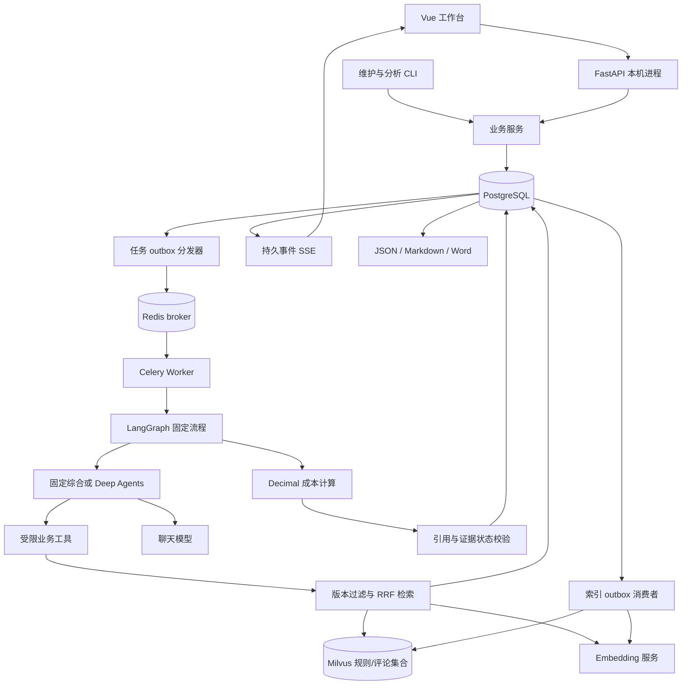

# 当前架构（0.6.0）

本页描述已实现代码；原六期设计在 `TikTok选品Agent技术架构方案-v2.md`，
验收证据以 `acceptance/` 下的各期报告为准。

## 组件与数据流

API、Worker、分发器为三个本机 Python 进程。分发器用 `--indexes` 时同时消费索引事件。
Vue 可以独立开发，也可以构建后由 FastAPI 提供静态文件。数据库、Redis 和 Milvus
由已有 Docker Compose 启动；没有引入 Kubernetes 或独立搜索集群。

## 事实、索引与快照

PostgreSQL 是事实源，Milvus 只负责向量候选召回。商品、原始证据、导入批次、
有效状态、索引事件和版本清单都可在数据库追溯。

导入在同一数据库事务中写入资料和索引 outbox；批次摘要相同则复用，
已有 ID 的内容不同则整体拒绝。证据显式更新/删除后由 outbox 最终同步到 Milvus。
同步事件可以重复和延迟；每次读取数据库最新版本，向量主键包含内容摘要，
清理旧版本时避免误删当前版本。软删除后检索立即经数据库过滤，物理向量随后清理。

集合身份包含证据类型、Embedding 提供方、模型、维度和预处理版本。
切换模型不会把不同向量空间写进同一集合。重建会重新 upsert 当前证据，
不依赖“清单已存在所以不用写”，也不自动删除其他模型的集合。

研究开始冻结商品、评论、规则和成本输入。检索同时检查市场、品类、商品范围、
观察时间、有效状态和快照内容摘要；模型只能引用已冻结的证据。
报告发布前再锁定并校验引用证据；期间被修改或删除则拒绝发布，
不把旧向量误当成当前有效事实。已发布报告保留历史快照，不因后续资料变更而静默改写。

## 研究与确定性边界

外层图为 `research → calculate → validate → persist`。
`fixed` 摘录原文用于工程验证；`prompt` 一次读取冻结资料；
默认 `workflow` 固定检索评论与规则再调用模型；`multi` 允许主 Agent
按需调用工具或委派评论、规则专项。两个专项共享父运行预算与证据边界。

模型产生结构化观察、推断、缺失信息与下一步建议，不能直接决定最终利润或任务完成状态。
所有模式使用同一 Decimal 成本计算器。价格情景为基准售价的 90%、100%、110%，
各费率按情景售价计算；缺少成本就列出缺失，不默认补零。

业务工具白名单在执行层实施，Deep Agents 默认文件和执行工具不可被任意调用。
任务笔记只服务当前研究。调用次数通过 PostgreSQL 行锁预留，
格式修复、专项模型调用及失败调用也纳入预算。SDK 自动重试关闭；
一次执行内最多一次格式修复，恢复后仍受持久总额度约束。

## 后台可靠性

创建任务、请求快照、初始事件和投递 outbox 在同一事务中完成。
分发器采用至少一次投递：发送后崩溃可能重投，Worker 必须幂等领取。
同一幂等键和相同请求复用任务；相同键不同请求返回 409。

Worker 领取后有 30 秒租约、5 秒心跳。恢复扫描增加 epoch，旧 Worker
在调用和持久化边界必须通过状态、epoch 和租约校验。报告保存与完成事件同事务，
数据库 advisory lock 防止同一检查点线程被并发恢复。
初次领取时固定墙钟截止时间；恢复不重置时间和已消费的调用次数，最多领取五次。

LangGraph 使用 PostgreSQL 检查点。已完成节点可复用，但尚未持久化的外部模型请求
可能重放，不能承诺供应商严格只计费一次。取消为协作式，`cancelling` 表示等待边界确认，
不代表外部请求已中止。已取消任务不能恢复成成功。

SSE 事件存入 PostgreSQL，以 `event_seq` 为游标，支持 `Last-Event-ID` 和 `after`。
页面刷新重放历史，重复事件按序号去重；断开浏览器不会取消任务。

## 报告与审计

`analysis_runs` 保存输入、快照、模型/提示词/计算版本及预算；
`analysis_calls` 保存调用状态、工具参数片段和可获得的 token。
`analysis_reports` 保存唯一报告及摘要；`report_exports` 按报告摘要、格式、
模板版本生成稳定制品，重复请求返回相同字节。

追问保存在 `report_questions`，只访问当前报告与冻结引用。
成本修订创建新任务并记录 `parent_run_id`；旧报告、旧数字和导出内容不变。
页面、JSON、Markdown、Word 都读取同一报告源。

## 已验证范围与限制

真实 PostgreSQL、Redis、Celery 和 Milvus 参与故障及复现验证；
真实兼容模型参加 9 次生成对照与 40 条检索查询。无外部服务的测试用于边界和故障注入，
不能取代这些集成结果。

系统当前只有单用户本机访问，无账号、租户隔离、分布式压测或生产 SLO。
共享 Python 环境复用不等于干净 OS 安装。Word 打印排版、独立人工引用支持率
仍未完成验收，所有数据均是合成资料。
