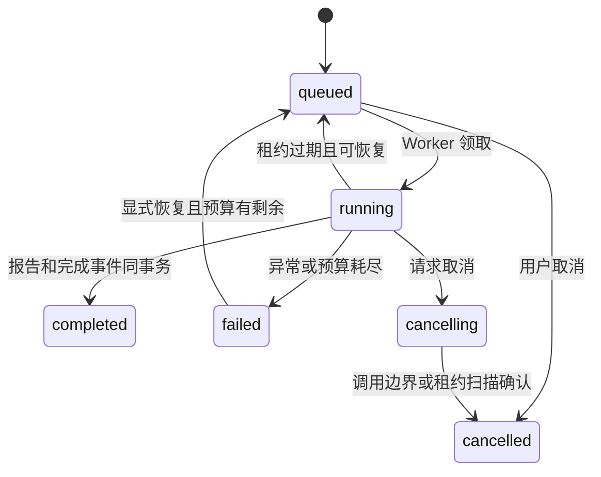

# 第四期：本地后台任务与恢复

API 继续在 PyCharm 本机运行，Docker 只提供数据库、Redis 和 Milvus。
需要四个独立进程：API、Worker、分发器、Vue 开发服务器。

```powershell
# 项目根目录；先迁移，再分别打开终端执行以下长期运行命令。
& D:\Programs\anaconda3\envs\py12\python.exe -m alembic upgrade head
& D:\Programs\anaconda3\envs\py12\python.exe -m uvicorn app.main:app --host 127.0.0.1 --port 8000
& D:\Programs\anaconda3\envs\py12\python.exe -m celery -A app.workers.celery_app:celery_app worker --pool=solo --loglevel=INFO
& D:\Programs\anaconda3\envs\py12\python.exe -m app.workers.dispatcher

# 另一个终端
cd frontend
npm ci
npm run dev
```

浏览器打开终端打印的本地 Vite 地址，默认 `http://127.0.0.1:5173`。
PyCharm 的 Worker 配置选择模块 `celery`，参数同上；分发器选择模块
`app.workers.dispatcher`。各 Python 进程的工作目录均为项目根目录，
解释器使用已有 py12 环境。Windows 开发用 solo；部署到 Linux 后再选择合适进程池。

`fixed` 不调用聊天模型，适合先验证调度；`multi` 需要真实模型配置及第三期索引。
创建任务后一直 queued，先看分发器和 Worker 是否都启动；HTTP 服务成功启动
并不意味着后台进程已经启动。无需另启 Celery Beat。
分发器增加 `--indexes` 后会同时消费证据索引事件；单次维护使用 `--once`。

## 状态、租约与预算



幂等键对同一请求复用原任务，对不同请求返回 409。
任务和投递 outbox 同事务保存；Redis 暂时不可用时，分发器会退避重试。
发送后尚未标记成功就崩溃时允许重投，因此 Worker 不依赖“只收到一次”。

Worker 租约 30 秒，每 5 秒由独立线程续租。扫描恢复先递增 epoch，
旧 Worker 的状态、报告和调用边界写入会被拒绝。PostgreSQL advisory lock
进一步防止同一 graph thread 并发恢复。自动领取最多 5 次。
第一次领取时冻结墙钟截止时间，恢复不重置；停机等待也计入该时间。
时间或调用额度耗尽时需明确创建新任务，不伪装成一次无限恢复。

取消是协作式的；已发送的模型请求可能继续消耗供应商额度。页面显示 cancelling
期间不要将它当作进程已经停止。取消后不能被迟到结果覆盖为 completed。
已取消任务要重新执行，请新建任务；失败任务可尝试从检查点恢复。

## SSE 与排障

`GET /api/tasks/{id}/events` 从 PostgreSQL 读取事件，id 为递增 event_seq。
支持 `Last-Event-ID` 和 `?after=N`。客户端按序号去重，刷新时从 0 回放历史。
断开订阅不取消后台任务。完成事件与报告在同一事务写入。

若 Worker 被强制停止，重启 Worker 和分发器后等待租约过期扫描；
无需删除 Redis 队列或数据库记录。未持久化的外部模型调用可能再次发生，
本项目不承诺供应商请求严格执行一次。

调用日志和 token 在 analysis_calls，任务时间线在 task_events，
分发情况在 task_dispatches。接口保持绑定回环地址，本期没有多用户权限系统。
