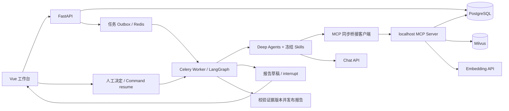

# 第七期方案：工具协议、研究方法、记忆与人工复核

本期以 `codex/v6` 为基础，保留 Deep Agents、Milvus、PostgreSQL、Celery 和现有工作台。交付分支为 `codex/v7`，不改写用户 `.env`。

## 目标与边界

| 能力 | 本期实现 | 边界 |
| --- | --- | --- |
| MCP | 六个只读证据工具，Streamable HTTP 服务与同步桥接客户端 | 不新增没有凭据的数据源；模型、成本计算和写报告不包装为 MCP |
| Skills | 评论分析、规则核验、冲突研究三个原生 Skill | 是研究方法，不是事实库；按任务冻结内容与摘要 |
| 记忆 | 报告会话最近六轮、结构化偏好、候选偏好确认 | 单用户本地项目；不把模型输出自动保存为市场事实 |
| HITL | 草稿批准、拒绝、提出修改后创建新任务 | 只在用户要求或缺失/冲突条件下触发，不逐个审批只读查询 |

## 执行架构

MCP 使用官方 Python SDK，避免引入已归档适配器，也不为适配器升级整个模型栈。同步 LangGraph 中用 AnyIO portal 管理一个完整异步会话，连接、调用与关闭均在同一事件循环内。业务工具定义和本地执行复用，工具 schema 在连接时校验。每个实际工具尝试由现有预算中间件计数一次；协议初始化不作为模型业务调用。

服务端从签名请求头绑定运行、快照及 Worker epoch，模型参数没有商品/市场/运行选择权。服务绑定回环地址；每次调用前后校验任务状态、租约与当前证据有效性。错误作为错误返回，不能伪装为空检索。服务端和客户端共用 `MCP_SHARED_SECRET`，不写入日志。默认保持本地工具，通过 `EVIDENCE_TRANSPORT=mcp` 启用网络协议。

Skills 的 Markdown 文件在创建任务时冻结到版本 JSON；运行和恢复使用冻结内容。原生 SkillsMiddleware 从只读内存后端发现技能，模型只获准 `read_file` 读取这些文件，不能读取 `.env` 或修改文件。主 Agent 与专项 Agent 显式传入各自技能目录。

## 记忆设计

报告会话绑定不可变报告 hash，最多带入最近六轮成功问答，每段限制长度；新会话不会继承另一报告的历史。不自动摘要，以免摘要失真被误当事实。引用定位模式仍为确定性查找；只有 model 模式理解连续指代。

偏好仅含目标市场、排除品类、回答语言。用户直接保存立即生效；推断出的候选偏好必须确认、修改或忽略。偏好在任务创建时冻结，供模型参考，不能覆盖商品市场、证据或明确问题。删除偏好影响后续任务，历史运行保留审计快照。单用户模式没有虚构用户鉴权；不得直接暴露到公网。

## 人工复核与恢复

任务增加 `waiting_for_review`。图执行 `研究 → 计算 → 校验 → 复核 → 发布`。复核策略支持 off/auto/always：auto 在成本不完整、研究缺失项或显式冲突提示出现时触发。

复核节点先幂等保存草稿，再执行 LangGraph `interrupt()`。外层确认检查点已返回中断后，将任务转为等待并释放租约。等待记录剩余计算秒数；批准重新投递时恢复剩余时限，模型/工具计数保持不变。人工等待没有自动过期，用户可取消；故障恢复扫描不领取等待任务。

批准绑定草稿摘要，决定和 outbox 在同一事务保存；重复相同决定幂等，过期摘要或相反决定返回冲突。Worker 读取持久决定，用原 thread_id 和 `Command(resume=...)` 恢复。发布前再校验证据版本，旧证据不因人工批准获得豁免。拒绝直接终止；提出修改保留原草稿并创建带反馈的新任务，必须再次复核。

## 验收

1. 原有测试回归、Ruff、前端构建通过。
2. 实际 HTTP MCP 六工具发现/调用、越权与失效上下文拒绝、服务异常传播。
3. Skill 原生发现与读取、路径隔离、修改磁盘文件不影响旧运行。
4. 会话隔离与多轮上下文、偏好 CRUD、候选确认和冻结生效。
5. 实际 PostgreSQL 检查点中断/重启/批准发布；拒绝、取消、重复决定、过期摘要、预算与证据变更测试。
6. 真实模型示例单独标明调用结果和限制，不将 mock 测试称为真实模型验收。

参考：[Deep Agents Skills](https://docs.langchain.com/oss/python/deepagents/skills)、[LangGraph Interrupts](https://docs.langchain.com/oss/python/langgraph/interrupts)、[MCP Python SDK](https://github.com/modelcontextprotocol/python-sdk)。
